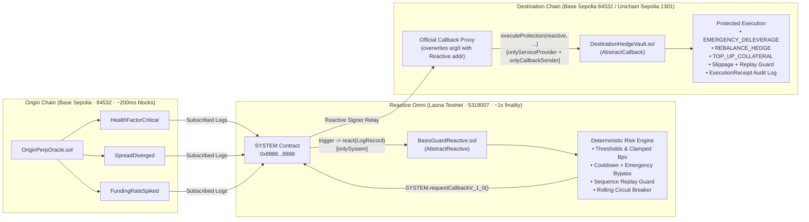

# BasisGuard Reactive

**Autonomous Cross-Chain Basis-Spread & Liquidation Sentinel built natively on Reactive Omni (`reactive-lib-omni`).**

Target Track: **Reactive Omni Buildathon — Track 1: Every Second Counts** (low-latency, event-driven cross-chain DeFi automation across **Base Sepolia** ~200ms blocks, **Reactive Lasna Testnet** ~1s CometBFT finality, and **Unichain Sepolia / Base Sepolia** destination vaults).

---

## Why BasisGuard Reactive?

Delta-neutral basis traders (long spot + short perpetual futures) earn funding yield until a sharp mark-index basis dislocation, funding spike, or margin drawdown hits during high volatility. Traditional keeper bots introduce off-chain latency, single points of failure, and RPC rate-limit risk precisely when sub-second liquidation protection matters most.

**BasisGuard Reactive** eliminates centralized off-chain keepers completely:
1. **`OriginPerpOracle`** (Origin Chain — Base Sepolia) publishes mark/index prices, computes signed basis spreads on-chain, and emits canonical `HealthFactorCritical`, `SpreadDiverged`, and `FundingRateSpiked` events.
2. **`BasisGuardReactive`** (Reactive Omni — Lasna Testnet, inheriting official `@reactive/src/base/AbstractReactive.sol`) subscribes directly to `SYSTEM` (`0x8888888888888888888888888888888888888888`), runs a deterministic on-chain risk engine inside `react()`, enforces per-vault cooldowns (with emergency liquidation bypass), monotonic sequence replay protection, and a rolling-window circuit breaker, then dispatches cross-chain actions via `SYSTEM.requestCallbackV_1_0(...)`.
3. **`DestinationHedgeVault`** (Destination Chain — Base Sepolia or Unichain Sepolia, inheriting official `@reactive/src/base/AbstractCallback.sol`) authenticates every callback with **both** `onlyServiceProvider` (official Callback Proxy) and `onlyCallbackSender` (160-bit injected Reactive Contract identity), enforces slippage & replay guardrails, executes protective deleveraging / delta-neutral hedge rebalancing / reserve collateral top-ups, and persists immutable `ExecutionReceipt` records on-chain.

---

## Architecture



---

## Contract Specifications

| Contract | Chain | Base Contract | Key Responsibilities |
|---|---|---|---|
| `src/BasisGuardTypes.sol` | Shared | Library | `ActionType`, `SuppressionReason`, `RiskConfig`, canonical `topic0` hashes |
| `src/OriginPerpOracle.sol` | Base Sepolia (`84532`) | Standalone | Computes signed basis spread bps, tracks monotonic per-vault sequences, emits `HealthFactorCritical`, `SpreadDiverged`, `FundingRateSpiked` |
| `src/BasisGuardReactive.sol` | Reactive Lasna (`5318007`) | `AbstractReactive` (`reactive-lib-omni`) | Subscribes via `SYSTEM.subscribe`, evaluates risk thresholds & guards in `react()`, dispatches via `SYSTEM.requestCallbackV_1_0`, supports `pause()`/`unpause()` & `coverDebt()` |
| `src/DestinationHedgeVault.sol` | Base Sepolia (`84532`) / Unichain Sepolia (`1301`) | `AbstractCallback` (`reactive-lib-omni`) | Dual-authenticated callback receiver (`onlyServiceProvider` + `onlyCallbackSender`), enforces action caps, slippage limits, `executedActions` replay guard, stores immutable `ExecutionReceipt`s |

---

## Official Reactive Omni Testnet Parameters

| Network | Chain ID | RPC URL | Official Contract Address |
|---|---|---|---|
| **Reactive Lasna** | `5318007` | `https://lasna-rpc.rnk.dev/` | System Contract: `0x8888888888888888888888888888888888888888` |
| **Base Sepolia** | `84532` | `https://sepolia.base.org` | Callback Proxy: `0x476F44b11F5C942c58f4c8E3d0300E5710743585` |
| **Unichain Sepolia** | `1301` | `https://sepolia.unichain.org` | Callback Proxy: `0x775c9B990ADe401060B78D0e98684eEf8d2466C1` |
| **Ethereum Sepolia** | `11155111` | `https://ethereum-sepolia-rpc.publicnode.com` | Callback Proxy: `0xAa14d9Cd0f788Ca23d11805986C1d8bd035D23b4` |

Testnet `lREACT` Faucet Contracts (1 testnet ETH → 100 `lREACT`, max 5 ETH/tx):
- Base Sepolia Faucet: `0x2afaFD298b23b62760711756088F75B7409f5967`
- Ethereum Sepolia Faucet: `0x9b9BB25f1A81078C544C829c5EB7822d747Cf434`

---

## Quickstart & Verification

### 1. Build & Run Full Foundry Test Suite (Unit + E2E Relay + Fuzz)

```bash
forge build
forge test -vv
```

The test suite etches a faithful `MockSystemContract` at the exact Reactive Omni `0x8888888888888888888888888888888888888888` address and simulates Reactive Omni's 160-bit payload sender injection inside `MockCallbackProxy`, validating:
- All 3 end-to-end cross-chain protection loops (`EMERGENCY_DELEVERAGE`, `REBALANCE_HEDGE` for positive & negative basis, `TOP_UP_COLLATERAL`)
- Threshold gating & clean non-reverting suppression (no wasted reactive gas)
- Per-vault cooldowns + critical health-factor emergency bypass (`HF < 1.05x`)
- Cross-chain replay & stale-sequence defense on both Lasna and Destination
- Rolling-window circuit breaker + dynamic `pause()`/`unpause()` subscription lifecycle
- Dual callback authentication (`onlyServiceProvider` + `onlyCallbackSender`), slippage guards, and Reactive Omni `pay()`/`coverDebt()` economy
- Fuzz tests verifying spread signs, clamped action magnitudes, and strictly improving post-deleverage health factors

### 2. Deploy Live on Base Sepolia + Reactive Lasna

```bash
cp .env.example .env
# Set PRIVATE_KEY in .env (wallet funded with ~0.2 Base Sepolia ETH)

# Swap 0.1 Base Sepolia ETH -> 10 lREACT on Lasna Testnet:
cast send 0x2afaFD298b23b62760711756088F75B7409f5967 \
  --rpc-url "$BASE_SEPOLIA_RPC" --private-key "$PRIVATE_KEY" \
  "request(address)" "$(cast wallet address --private-key "$PRIVATE_KEY")" --value 0.1ether

# Step 1: Deploy OriginPerpOracle on Base Sepolia
forge script script/Deploy.s.sol:DeployOrigin --rpc-url "$BASE_SEPOLIA_RPC" --broadcast

# Step 2: Deploy BasisGuardReactive on Reactive Lasna (auto-subscribes to OriginPerpOracle)
ORIGIN_ORACLE_ADDR=<step1_addr> forge script script/Deploy.s.sol:DeployReactive --rpc-url "$LASNA_RPC" --broadcast

# Step 3: Deploy DestinationHedgeVault on Base Sepolia (or Unichain Sepolia)
DESTINATION_CALLBACK_PROXY=0x476F44b11F5C942c58f4c8E3d0300E5710743585 \
REACTIVE_SENTINEL_ADDR=<step2_addr> \
forge script script/Deploy.s.sol:DeployDestination --rpc-url "$BASE_SEPOLIA_RPC" --broadcast

# Step 4: Wire DestinationHedgeVault into BasisGuardReactive on Lasna
REACTIVE_SENTINEL_ADDR=<step2_addr> DESTINATION_VAULT_ADDR=<step3_addr> \
forge script script/Deploy.s.sol:WireDestination --rpc-url "$LASNA_RPC" --broadcast

# Step 5: Trigger live HealthFactorCritical event on Origin Chain
ORIGIN_ORACLE_ADDR=<step1_addr> \
forge script script/Deploy.s.sol:TriggerLiveLoop --rpc-url "$BASE_SEPOLIA_RPC" --broadcast

# Step 6: Verify callback delivery on Lasna SYSTEM contract & Reactscan (https://lasna.reactscan.net)
cast call 0x8888888888888888888888888888888888888888 \
  "getCallbacks(uint256)((uint256,address,uint256,uint256,uint256,bytes)[])" \
  <REACTIVE_TX_HASH> --rpc-url https://lasna-rpc.rnk.dev/
```

---

## License

MIT
